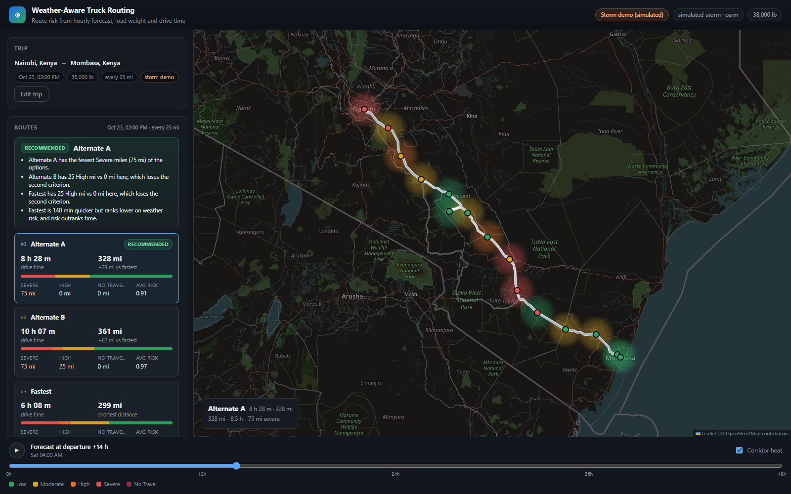
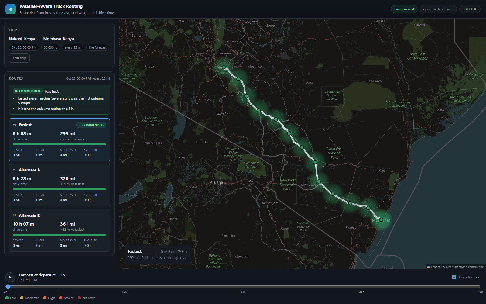
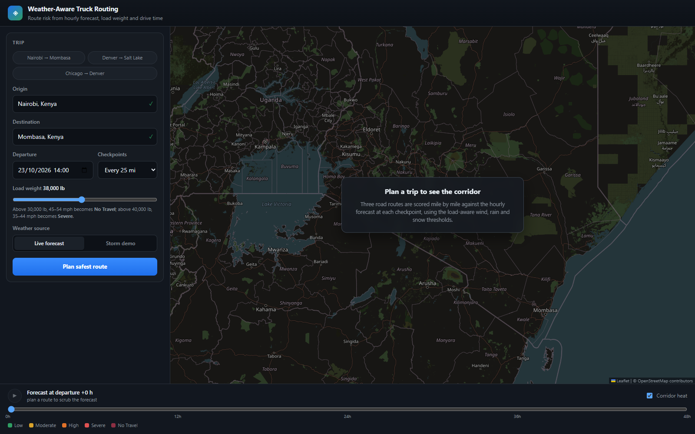

# Weather-Aware Truck Routing

A full-stack **React + Django** app that plans three road routes between two points and scores
each one, mile by mile, against the hourly weather forecast at the moment the truck would
actually be there — then recommends the safest route by the rules in the brief.



| Live forecast | Empty state |
| --- | --- |
|  |  |

---

## What it does

- **Trip input** — origin and destination (geocoded autocomplete), departure date/time, load
  weight, and checkpoint spacing of 10 / 25 / 50 miles.
- **Three route options** — real OSRM road routes. The public OSRM server ignores `alternatives`,
  so when it returns only one route the backend *synthesises* genuine alternatives by routing
  through a waypoint offset perpendicular to the fastest corridor (see
  [Alternative routes](#alternative-routes)).
- **Weather at arrival time** — each checkpoint is sampled every N miles and paired with the
  forecast hour matching its interpolated ETA, not the departure conditions.
- **Load-aware risk rules** — the wind / rain / snow thresholds and the two load escalation rules
  from the brief, implemented as a pure, table-tested module.
- **Recommendation** — ranked by fewest severe miles → fewest high miles → lowest average risk →
  shortest travel time, with a written rationale that cites the numbers.
- **Map** — colour-coded checkpoint markers, risk-tinted corridor heat map, and a 0–48 h
  forecast slider that re-scores the corridor at every hour offset.
- **Degrades gracefully** — if a provider fails, the API falls back to deterministic synthetic
  data and says so in `meta.degraded`; the UI never shows a blank map because of a third party.

## Quick start

Requirements: Python 3.12+, Node 20+.

```bash
# 1. backend
cd backend
python -m venv .venv
.venv/Scripts/activate          # Windows; use source .venv/bin/activate on macOS/Linux
pip install -r requirements.txt
python manage.py migrate
python manage.py runserver 8000

# 2. frontend (second terminal)
cd frontend
npm install
npm run dev                     # http://127.0.0.1:5173
```

The Vite dev server proxies `/api` to `127.0.0.1:8000`, so there is nothing to configure.
No API keys are required: routing is OSRM, geocoding is Nominatim, weather is Open-Meteo.

For an offline or CI run, point the app at deterministic providers:

```bash
ROUTING_PROVIDER=synthetic WEATHER_PROVIDER=synthetic python manage.py runserver 8000
```

## The risk model

### Classification

Straight from the brief. Buckets are half-open on the lower edge, so every value classifies
exactly once; the upper bound is inclusive where the brief writes a closed range
(`0.50–1.00` → Severe at exactly 1.00) and exclusive where it writes an open one
(`>1.00` → No Travel only above 1.00).

| Condition | Low | Moderate | High | Severe | No Travel |
| --- | --- | --- | --- | --- | --- |
| Wind (mph) | < 25 | 25 – <35 | 35 – <45 | 45 – <55 | ≥ 55 |
| Rain (in/hr) | < 0.10 | 0.10 – <0.25 | 0.25 – <0.50 | 0.50 – 1.00 | > 1.00 |
| Snow (in/hr) | < 0.5 | 0.5 – <1.0 | 1.0 – <2.0 | 2.0 – 3.0 | > 3.0 |

A checkpoint takes the **worst** of its three condition levels; the condition that produced it is
reported as `driver` so the popup can explain itself.

### Load escalation

| Rule | Effect |
| --- | --- |
| Wind ≥ 55 mph | No Travel, any load |
| Wind 45–54 mph **and** load > 30,000 lb | No Travel |
| Wind 35–44 mph **and** load > 40,000 lb | Severe |

The rules are applied *after* the weather classification and only ever raise the level — a calm
wind with heavy rain stays Severe. Because the escalation reads the raw wind value rather than the
wind bucket, the band edges stay exactly where the brief puts them.

This is why the UI defaults to 38,000 lb: above 40,000 lb the 35–44 mph band collapses from
High into Severe, and above 30,000 lb the 45–54 band becomes No Travel. Dragging the weight slider
makes that visible on the same route.

### Aggregation and ranking

Each checkpoint represents the stretch of road since the previous checkpoint, so
`severe + high + moderate + low + no_travel` adds up to the route distance (asserted in tests).
Routes are ordered lexicographically by:

1. no-travel miles — worse than any amount of merely severe road, so it leads,
2. severe miles,
3. high miles,
4. average risk (distance-weighted mean of the 0–4 levels),
5. drive time.

## Architecture

```
┌─────────────────────────────┐        ┌──────────────────────────────────────┐
│ React 19 + Vite + TypeScript│  POST  │ Django 5.2 + DRF                    │
│                             │ /api/  │                                      │
│  PlanForm ──► api.ts ───────┼───────►│  PlanView ──► planner.build_plan()   │
│  RouteList    (fetch)       │        │                 │                    │
│  RouteMap                   │◄───────┤                 ├─ routing.OsrmRouter│
│   ├ HeatLayer (canvas)      │  JSON  │                 ├─ weather.OpenMeteo │
│   └ CircleMarkers           │        │                 ├─ risk.assess()     │
│  Timeline (0–48 h)          │        │                 └─ geo.sample()      │
└─────────────────────────────┘        │  cache: routes 6 h · weather 15 min │
                                       └──────────────────────────────────────┘
```

```
backend/
  config/                 settings, urls, wsgi
  routing/
    views.py              POST /api/plan/, GET /api/geocode/, GET /api/meta/
    serializers.py        request validation with actionable messages
    throttles.py          per-IP burst limit so a public demo can't burn the quota
    services/
      geo.py              haversine, interpolation, sampling, corridor offsets
      risk.py             thresholds, load rules, aggregation, ranking
      routing.py          OSRM provider + via-point alternative synthesis
      weather.py          Open-Meteo batch client + deterministic storm field
      planner.py          orchestration: routes → checkpoints → weather → ranking
      cache.py, http.py   memoisation and a retrying JSON client
    tests/                76 tests: thresholds, geometry, planner, API contract
frontend/
  src/components/         PlanForm, PlaceInput, RouteList, RouteMap, HeatLayer, Timeline
  src/lib/risk.ts         colour ramp + formatting
  src/api.ts              typed client with error extraction
```

## API

### `POST /api/plan/`

```json
{
  "origin":      { "lat": -1.2921, "lon": 36.8219, "label": "Nairobi" },
  "destination": { "lat": -4.0435, "lon": 39.6682, "label": "Mombasa" },
  "depart_at": "2026-10-24T06:00:00+03:00",
  "weight_lb": 38000,
  "sample_interval_miles": 25,
  "horizon_hours": 48,
  "scenario": "live"
}
```

Returns `routes[]` (geometry, checkpoints with weather + risk, metrics, summary),
`recommendation` (route id + rationale), `heatmap` (corridor cells × 49 hours), `legend` and
`meta` (providers, degradation flags). Every field the UI renders comes from this one response,
so the map paints once and the slider is pure client state.

| Endpoint | Purpose |
| --- | --- |
| `GET /api/geocode/?q=Denver` | Cached Nominatim forward geocoding |
| `GET /api/meta/` | Providers, limits, legend — useful for smoke tests |
| `GET /health/` | Liveness probe for the platform |

Errors are structured: `400 invalid_request` (field errors), `422 unroutable`,
`502 upstream_unavailable`.

## Design decisions

**Why Open-Meteo, OSRM and Nominatim.** All three are keyless and permissive, which matters for a
take-home that a reviewer must be able to run without signing up for anything. The providers sit
behind small adapters (`routing.py`, `weather.py`, `geocoding.py`), so swapping in
OpenRouteService, Mapbox or a paid weather feed is a constructor change.

**Alternative routes.** The public OSRM demo returns a single route regardless of the
`alternatives` flag. Rather than fabricate geometry, the router asks for alternatives first and
falls back to routing through a waypoint offset ~12–30 miles perpendicular to the fastest path at
different fractions along it. Each candidate is therefore a real road route from the same engine,
with a real distance and duration. Candidates within 2% of an existing route's distance and within
2 miles of its shape are rejected as duplicates.

**ETAs.** Checkpoint ETA = departure + duration × (miles / total miles). OSRM's duration already
accounts for road class and speed limits, so proportional interpolation is a good approximation
and avoids a second routing call per checkpoint. The UI shows the ETA on every popup.

**Heat-map semantics.** For a slider offset `h`, checkpoint *i* is evaluated at
`departure + h + eta_i` — i.e. "what if we leave `h` hours later". At `h = 0` the heat map
agrees exactly with the checkpoint colours (asserted in `test_heatmap_hour_zero_matches_checkpoint_risk`),
which makes the slider a departure planner rather than a decorative animation.

**Storm demo.** Real weather is often calm, so the Severe and No Travel branches would never be
visible in a walkthrough. The "Storm demo" toggle swaps in a deterministic simulated system
(two travelling waves moving east) and is labelled as simulated in the header, the form and
`meta.weather_provider`. Live mode is untouched.

**Why a canvas heat layer.** A corridor is ~20–40 cells per route; drawing them as DOM markers and
redrawing on every slider tick and pan frame stutters. The layer paints radial gradients into one
canvas on `requestAnimationFrame`, positioned in a dedicated pane beneath the route lines.

## Performance

- **Caching** — routes cached 6 h per rounded endpoint pair, weather 15 min per rounded cell and
  forecast window, geocoding 24 h. A repeat plan is ~0.4–0.5 s end to end.
- **Batching** — Open-Meteo accepts many coordinates per request, so a 44-checkpoint trip is three
  HTTP calls, issued concurrently.
- **Parallel detours** — the four via-point strategies run in a thread pool; a cold plan is
  ~2–6 s depending on the public OSRM server, a warm one under half a second.
- **Gzip** — `GZipMiddleware` compresses the ~90 KB JSON payload.
- **Payload discipline** — geometry is downsampled to ≤900 points per route; heat cells carry only
  the 49 risk levels per cell, not raw weather.

## Testing

```bash
cd backend && pytest        # 76 tests
cd frontend && npx tsc --noEmit && npm run build
```

Coverage focuses on the parts that are easy to get subtly wrong:

- every threshold probed on both sides (24.9 / 25.0, 54.9 / 55.0, 1.00 / 1.01, …),
- all three load rules plus the "never demote" invariant,
- geometry: haversine against a known city pair, spacing, endpoint clamping, max-sample guard,
- planner: three distinct routes, ranking consistency, segment miles summing to route distance,
  ETAs monotonic and starting at departure, heat map length, hour-0 agreement, determinism,
- API: validation rejections, happy path, meta and health endpoints.

The planner tests run against the synthetic providers, so the suite never touches the network.

## Deployment

Two free-tier services; both configs are in the repo.

**Backend — Render** (`render.yaml`): create a Blueprint from the repo, then set
`DJANGO_SECRET_KEY`, `DJANGO_ALLOWED_HOSTS` and `CORS_ALLOWED_ORIGINS` to your Vercel URL.

**Frontend — Vercel** (`frontend/vercel.json`): import the repo, set the root directory to
`frontend`, and add `VITE_API_BASE=https://<your-render-service>.onrender.com`.

Locally the frontend calls same-origin `/api` through the Vite proxy; in production it calls the
absolute API base, which is why CORS is configured on the backend.

## Known limitations

- OSRM's public demo server is rate limited and occasionally slow; production should use a
  self-hosted OSRM or a commercial routing API.
- ETAs use proportional distance interpolation, not per-segment speed annotations; adding
  `annotations=duration` would sharpen mountain-pass sections.
- Snow is only produced by the simulated field; Open-Meteo reports snowfall, but most corridors
  outside winter will never exercise that branch.
- Weight is a single scalar — axle loads and bridge restrictions are out of scope.
